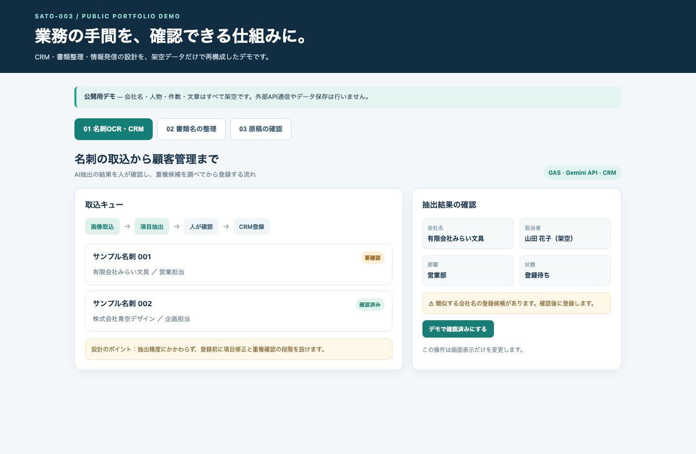
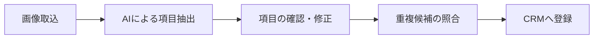
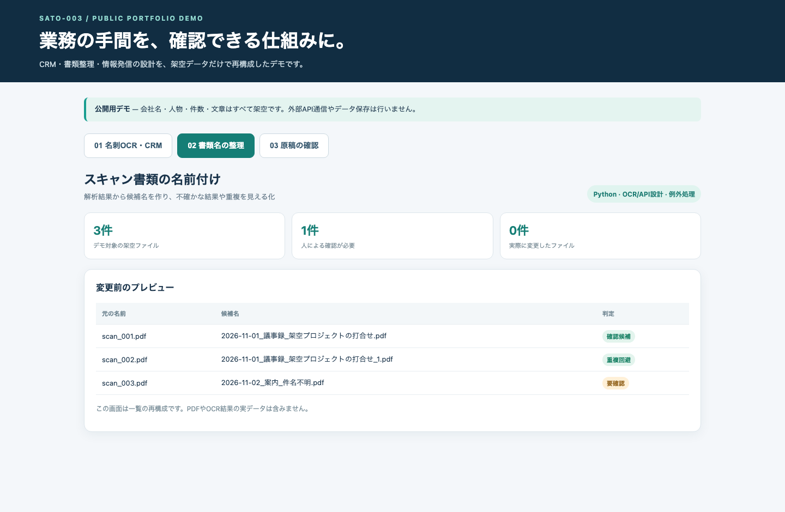
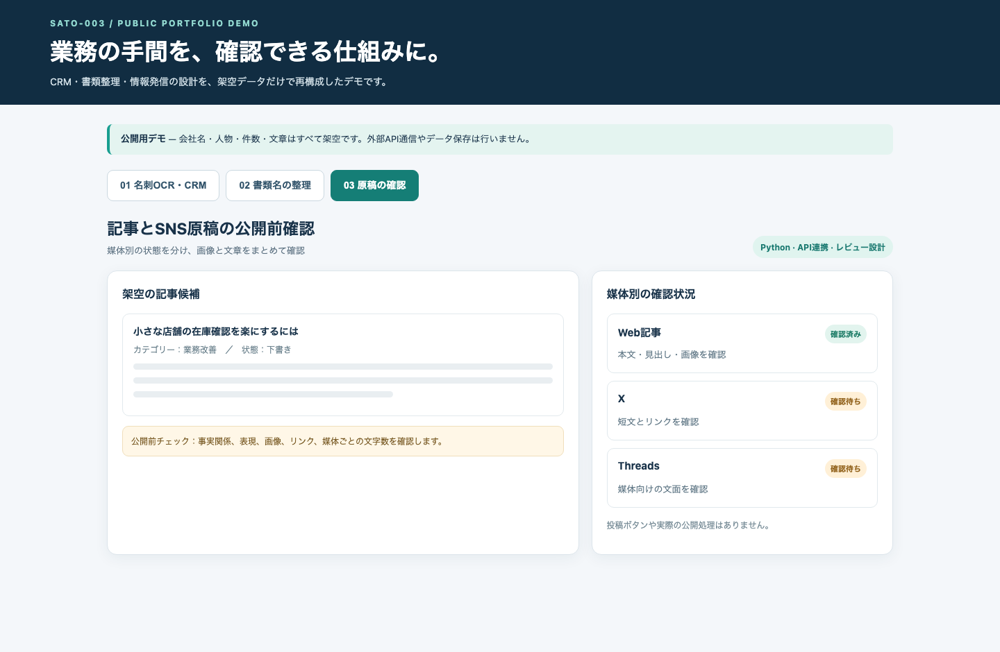

# 業務自動化・生成AI活用 ポートフォリオ

Python / Google Apps Script / API / CRM を使い、手作業の多い業務を「確認できる自動化」に変える開発事例です。公開画面・サンプルデータ・コードは、このポートフォリオのために新規作成したデモです。実運用のソース、顧客情報、画像、設定、プロンプトは含みません。

**[デモ画面を見る](https://sato-003.github.io/business-automation-ai-portfolio/)** · **[制作実績（会社サイト）](https://aidech-management.com/works.php)**



## 事例

| 事例 | 背景と課題 | 設計と担当した領域 | 効果の捉え方 |
| --- | --- | --- | --- |
| 名刺OCR・CRM | 名刺からの転記と、登録後の検索・対応履歴管理が分かれている | 画像取込 → AI抽出 → 人による確認 → 重複候補判定 → CRM登録。業務フローの整理、画面・データ設計、実装と改善 | 入力の省力化と、誤読・重複を登録前に見つけやすくする。定量値は[制作実績](https://aidech-management.com/works.php)の**試算例**であり実測値ではありません |
| スキャン書類の整理 | PDFを一つずつ開いて内容を確認し、名称を付けている | Pythonでファイル名候補を生成し、同名衝突や不確かな結果を確認対象にする。処理フロー、例外処理、実行結果の設計・実装 | 一括処理しつつ、変更前に確認できる。実測の削減時間はここでは主張しません |
| 記事・SNS原稿の確認 | 媒体ごとの本文・画像・公開状況が分散する | 原稿候補をまとめ、媒体ごとの状態を分け、公開前に人が確認するフローを設計・実装 | 確認漏れと重複操作を減らす設計。自動公開の成果や運用実績はこのデモで再現していません |

### 1. 名刺OCR・CRM

実開発では Google Apps Script、Google Sheets / Drive、Gemini API を用いた名刺管理の仕組みを扱っています。公開デモではOCR通信を行わず、**架空の抽出結果**を用いて確認・重複判定・登録待ちの状態を表現しました。AIの結果をそのまま確定せず、人が修正できることを重視しています。[GASの再実装例](examples/crm_review.gs)は確認済みフラグと重複照合の流れを示します。



### 2. スキャン書類の整理

実開発では Python と画像解析APIを用いたPDF名付け支援を扱っています。公開コードの[`document_namer.py`](examples/document_namer.py)は**架空の解析結果だけ**を入力にして、ファイル名の正規化、重複回避、要確認判定を示します。PDF・OCR・API接続、実際の文書名は含みません。



### 3. 記事・SNS原稿の確認

実開発では Python による情報収集・生成支援、Web管理画面、外部APIとの連携を扱っています。公開デモは公開前レビューの画面だけを再構成しています。原稿は架空であり、媒体への送信は行いません。



## 技術スタックと設計上の工夫

| 領域 | 実開発で扱った技術 | この公開デモ |
| --- | --- | --- |
| 業務アプリ・CRM | Google Apps Script、Google Sheets / Drive、Next.js、Supabase | HTML / CSS / JavaScript の静的画面 |
| 生成AI・API | Gemini API、OpenAI API、OCR、外部API連携 | 架空の応答データのみ。APIキー・通信なし |
| 自動化 | Python、バッチ処理、例外処理 | 標準ライブラリだけで動く安全なファイル名候補生成 |

- **Human in the loop**: OCRや生成AIの結果を確定前に確認・修正できる構成。
- **冪等性・重複対策**: 同じ入力の再処理や既存レコードとの照合を考慮。
- **失敗を見える化**: エラーや要確認を成功と混ぜず、次の操作が分かる状態にする。
- **秘密の分離**: APIキーや接続情報をコードや画面に置かない。

## デモの使い方

`demo/index.html`をブラウザで開いてください。3つの事例を切り替えられます。表示する社名・人物・数値・文章はすべて架空です。デモ画面は通信やデータ保存を行いません。

Pythonの再実装例:

```bash
python3 examples/document_namer.py
```

## 公開範囲

このリポジトリは**技術と設計判断を説明するための再実装**です。元の非公開リポジトリからのコード、顧客名、個人情報、業務データ、認証情報、内部URL、プロンプト、実画面のスクリーンショットは公開していません。画像は架空データのデモ画面を撮影したものです。本人の担当範囲は上記の業務設計・実装と改善であり、実案件での効果を示す定量値は掲載していません。
